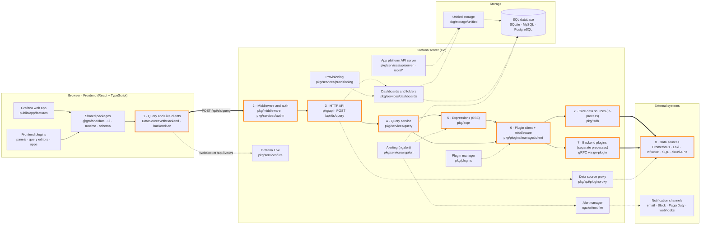

# Grafana architecture overview

This page explains how Grafana is put together: the frontend, the Go server, storage, plugins, and the external systems Grafana talks to. It follows one query from a dashboard panel to a data source and back, and links to the source directories for each component.

For a presentation-ready version of the same diagram, open [`grafana-architecture.html`](grafana-architecture.html) in a browser. It's self-contained and works offline.

Before you begin, it helps to know the following:

- **Repository layout:** Go backend code lives in `pkg/`, the frontend app in `public/app/`, and shared frontend packages in `packages/`.
- **Plugin model:** Grafana extends itself with panel, data source, and app plugins. Data source plugins can have a frontend part, a backend part, or both.

## Diagram

The diagram groups components into the browser, the Grafana server, storage, and external systems. Thick arrows show the query path, numbered in the order a request travels. Dotted arrows show other dependencies.

## Query path

This section follows one query from a dashboard panel to a data source. The numbers match the diagram.

1. **Frontend client:** A panel or Explore runs a query. `DataSourceWithBackend` in `@grafana/runtime` sends `POST /api/ds/query` with the queries and the time range.
1. **Middleware and auth:** Middleware authenticates the caller (session cookie, API key, service account token, OAuth, or JWT) and builds the request context. The route checks the `datasources:query` RBAC action.
1. **HTTP API:** The handler in `pkg/api/ds_query.go` decodes the request and calls the query service.
1. **Query service:** `pkg/services/query` resolves each data source, groups queries by data source, and runs the groups concurrently.
1. **Expressions:** If the request contains expressions (data source UID `__expr__`), the server-side expression engine in `pkg/expr` builds a dependency graph. It runs the data source queries first, then math, reduce, resample, threshold, and SQL nodes over the results.
1. **Plugin client:** The plugin client runs a chain of client middleware from `pkg/services/pluginsintegration/clientmiddleware` (auth headers, caching, tracing, metrics, logging) and calls `QueryData`.
1. **Plugin:** Core data sources registered in `pkg/services/pluginsintegration/coreplugin` run in-process. External backend plugins run as separate processes, and Grafana calls them over gRPC.
1. **Data source:** The plugin queries the external system in its native protocol. Results return as data frames along the same path, and the browser renders them in the panel.

## Components

This section describes each component in the diagram and links to its source.

### Frontend

The frontend is a React and TypeScript single-page app. The Go server serves it and its bootstrap data.

- **Web app:** Feature areas such as dashboards, Explore, alerting, and connections live in [`public/app/features`](../../public/app/features). Dashboards are built with Scenes in [`public/app/features/dashboard-scene`](../../public/app/features/dashboard-scene).
- **Shared packages:** [`packages/`](../../packages) holds `@grafana/data` (data frames and types), `@grafana/ui` (components), `@grafana/runtime` (services such as `backendSrv`, `getDataSourceSrv`, and Live), and `@grafana/schema` (types generated from CUE in [`kinds/`](../../kinds)). `@grafana/scenes` is an npm dependency.
- **Frontend plugins:** Built-in panels live in [`public/app/plugins/panel`](../../public/app/plugins/panel) and data source UIs in [`public/app/plugins/datasource`](../../public/app/plugins/datasource). The plugin loader in [`public/app/features/plugins`](../../public/app/features/plugins) loads plugin bundles at runtime.

### Grafana server

The server is a single Go binary. [`pkg/server`](../../pkg/server) wires services together with Wire dependency injection, and [`pkg/modules`](../../pkg/modules) lets parts of it run as separate targets.

- **Middleware and auth:** [`pkg/middleware`](../../pkg/middleware) adds headers, gzip, and request metadata. [`pkg/services/contexthandler`](../../pkg/services/contexthandler) and [`pkg/services/authn`](../../pkg/services/authn) identify the caller, and [`pkg/services/accesscontrol`](../../pkg/services/accesscontrol) enforces RBAC.
- **HTTP API:** [`pkg/api`](../../pkg/api) registers the classic `/api/*` routes in `api.go` and holds their handlers.
- **App platform API server:** [`pkg/services/apiserver`](../../pkg/services/apiserver) serves Kubernetes-style resources under `/apis/*`. API groups are registered in [`pkg/registry/apis`](../../pkg/registry/apis), and standalone apps live in [`apps/`](../../apps).
- **Domain services:** Business logic lives in [`pkg/services`](../../pkg/services), for example [`dashboards`](../../pkg/services/dashboards), [`folder`](../../pkg/services/folder), [`datasources`](../../pkg/services/datasources), [`annotations`](../../pkg/services/annotations), and [`search`](../../pkg/services/search).
- **Query service and expressions:** [`pkg/services/query`](../../pkg/services/query) fans out queries, and [`pkg/expr`](../../pkg/expr) implements server-side expressions.
- **Data source proxy:** [`pkg/api/pluginproxy`](../../pkg/api/pluginproxy) and [`pkg/services/datasourceproxy`](../../pkg/services/datasourceproxy) forward HTTP calls from frontend-only data sources to the data source, adding credentials on the server side.
- **Provisioning:** [`pkg/services/provisioning`](../../pkg/services/provisioning) reads YAML files (examples in [`conf/provisioning`](../../conf/provisioning)) to create data sources, dashboards, plugins, and alerting resources.

### Plugins

Grafana discovers, verifies, and runs plugins through the plugin system.

- **Plugin manager:** [`pkg/plugins`](../../pkg/plugins) discovers, validates signatures, and loads plugins. [`pkg/services/pluginsintegration`](../../pkg/services/pluginsintegration) connects it to the rest of Grafana.
- **Core data sources:** [`pkg/tsdb`](../../pkg/tsdb) holds the built-in backends: Prometheus, Loki, InfluxDB, Graphite, CloudWatch, Azure Monitor, MySQL, TestData, and the Grafana data source.
- **Backend plugins over gRPC:** [`pkg/plugins/backendplugin/grpcplugin`](../../pkg/plugins/backendplugin/grpcplugin) starts external plugins as child processes with HashiCorp go-plugin. Plugins built with `grafana-plugin-sdk-go` implement `QueryData`, `CallResource`, `CheckHealth`, and streaming.

### Alerting

[`pkg/services/ngalert`](../../pkg/services/ngalert) is Grafana Alerting. The scheduler (`schedule`) evaluates rules on an interval through the same expression and plugin path as dashboards (`eval`). The state manager (`state`) tracks alert instances. The notifier (`notifier`) embeds an Alertmanager that routes and sends notifications.

### Grafana Live

[`pkg/services/live`](../../pkg/services/live) is a WebSocket hub built on Centrifuge, served at `/api/live/ws`. It streams data from backend plugins (`RunStream`), dashboard change events, and metrics pushed over HTTP or WebSocket.

### Storage

Grafana keeps its own state in a SQL database and, for app platform resources, in unified storage.

- **SQL database:** [`pkg/services/sqlstore`](../../pkg/services/sqlstore) connects to SQLite (the default), MySQL, or PostgreSQL. Schema changes live in [`pkg/services/sqlstore/migrations`](../../pkg/services/sqlstore/migrations).
- **Unified storage:** [`pkg/storage/unified`](../../pkg/storage/unified) stores Kubernetes-style objects in `resource` and `resource_history` tables and maintains a search index. It runs in-process by default or as a standalone gRPC storage server. Dual-writer modes migrate resources from legacy tables.

## Accuracy notes

The diagram is a simplified view based on the `main` branch of this repository.

- **Not every service:** Many services, such as reporting, cloud migration, and secrets, aren't shown.
- **Legacy and unified paths:** Some resources, such as dashboards and folders, read and write through either legacy SQL tables or unified storage, depending on configuration and feature toggles.
- **Query service variants:** The query service can also route data source queries through a Kubernetes-style query API client instead of calling the plugin client directly.

## Next steps

- Refer to [`AGENTS.md`](../../AGENTS.md) for build, run, and test commands.
- Refer to [`pkg/storage/unified/README.md`](../../pkg/storage/unified/README.md) for unified storage configuration.
- Refer to [`pkg/services/ngalert/README.md`](../../pkg/services/ngalert/README.md) for alerting internals.
